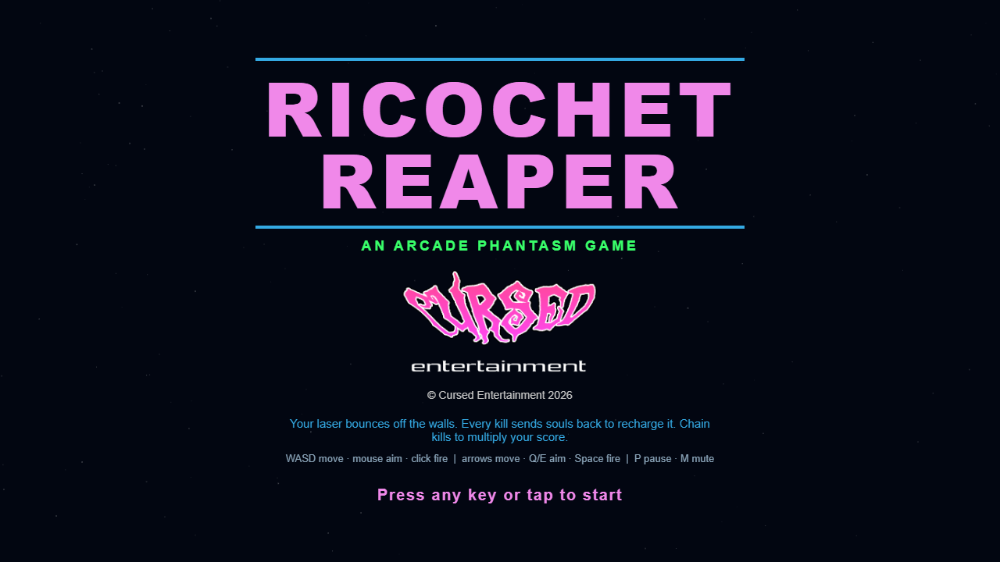
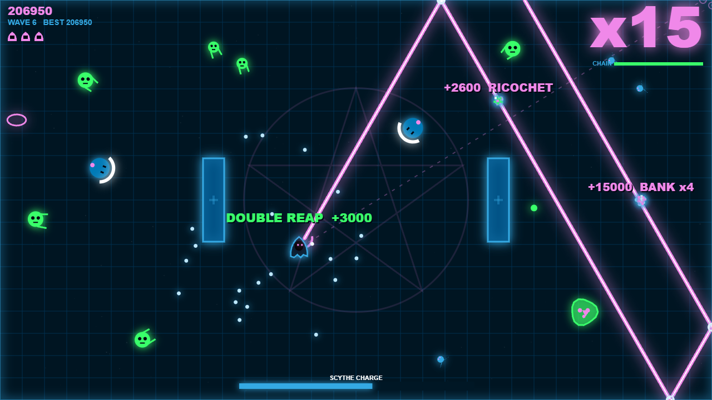

 

  

 

  
  
  

 

# RICOCHET REAPER

**An [Arcade Phantasm](https://arcade-phantasm.netlify.app/) game**

### [Play it](https://cursedprograms.github.io/RicochetReaper/)

A frantic arena shooter. You're a hooded reaper whose scythe fires a laser, and enemies pour in from every direction. Your laser charge is limited: every kill releases souls that fly back to you and refill it. Chain kills to multiply your score and survive ever more aggressive waves.

**The twist:** Your laser bounces off the arena walls and the pillars, so the best shots are complicated ricochets. A bounced shot scores more, releases more souls and is the only way to hit a shielded knight from the front.

  
  

## How to play

- **Reap and recharge.** Each shot costs charge (the bar at the bottom). Kills send souls flying back to you; touch them to refill. Run dry and the scythe only trickles back.
- **Chain kills.** Every kill inside the chain timer raises the multiplier (top right); bounced kills raise it by two. Several kills with one shot score a DOUBLE / TRIPLE / QUAD REAP bonus.
- **Bank your shots.** The laser bounces up to three times. The faint dashed line shows where your first two bounces will go. One bounce is a RICOCHET (double points), two or more a BANK shot (x3, x4).
- **Know your enemies.** Ghouls shamble at you; bats swoop in fast; splitters burst into three when killed; shield knights block any direct shot from the front (hit them from behind, or bounce a shot into them); witches keep their distance and throw curses (your laser burns them out of the air).
- You have three lives; a hit throws back everything near you and breaks your chain. Clearing every fifth wave gives you a life back. The arena's pillars change every two waves.

## Controls

| | Keyboard + mouse | Keyboard only | Phone / tablet |
| --- | --- | --- | --- |
| Move | WASD | Arrow keys | Left thumb stick (left half of the screen) |
| Aim | Mouse | Q / E (or Z / X), or the way you walk | Right thumb stick |
| Fire | Left mouse button (hold) | Space (or J / K) | Push the right stick |
| Pause / mute | P / M | P / M | II / ♪ at the top |

The best score is saved in the browser.

## Versions

- **Browser** (this repo's root): [play it](https://cursedprograms.github.io/RicochetReaper/)
- **Windows exe**: coming, in `cpp/`
- **Android**: in `android/`, the APK in [`android/apk/`](android/apk/) (see [Android](#android) below)

## Android

The browser game in an Android app: it plays offline, full screen in landscape, with the sound on from the start
(Android 7.0 or newer).

- **Download**: the APK in [`android/apk/`](android/apk/). Copy it to the phone and open it (allow installs from
  unknown sources when asked).
- **Build it**: the Android SDK and JDK 17, then `android/build.bat` (or `build.ps1`, `build.sh`). It runs
  `gradlew assembleDebug` and leaves the APK in `android/apk/`. The game's web files are copied into the app at build
  time, so the browser game at the repo root stays the only copy.
- **The code**: `android/app/src/main/java/com/synthwomb/ricochetreaper/MainActivity.kt`, a full-screen WebView that serves the
  game from the app's assets. Press Back twice to leave.

## Files

- `index.html`: the page (the canvas and the title screen)
- `site/style.css`: the page's styling
- `site/game.js`: the game: arena, ricochet ray casting, enemies, waves, chains, drawing, controls
- `site/sfx.js`: every sound, made with the Web Audio API (no audio files)
- `images/`: the Cursed logo and the screenshots

Plain HTML5 canvas and JavaScript, no frameworks and no build step. Open `index.html#shot` for the frozen mid-battle scene used for the screenshot.

## Also in the arcade

[KillerStardust](https://github.com/CursedPrograms/KillerStardust) · ProtocolHex · Seance · [RicochetReaper](https://github.com/CursedPrograms/RicochetReaper) · [GraveDanger](https://github.com/CursedPrograms/GraveDanger) · Vortex · Orbit · RocksOfRuin · Devourer

 

© Cursed Entertainment 2026

 

